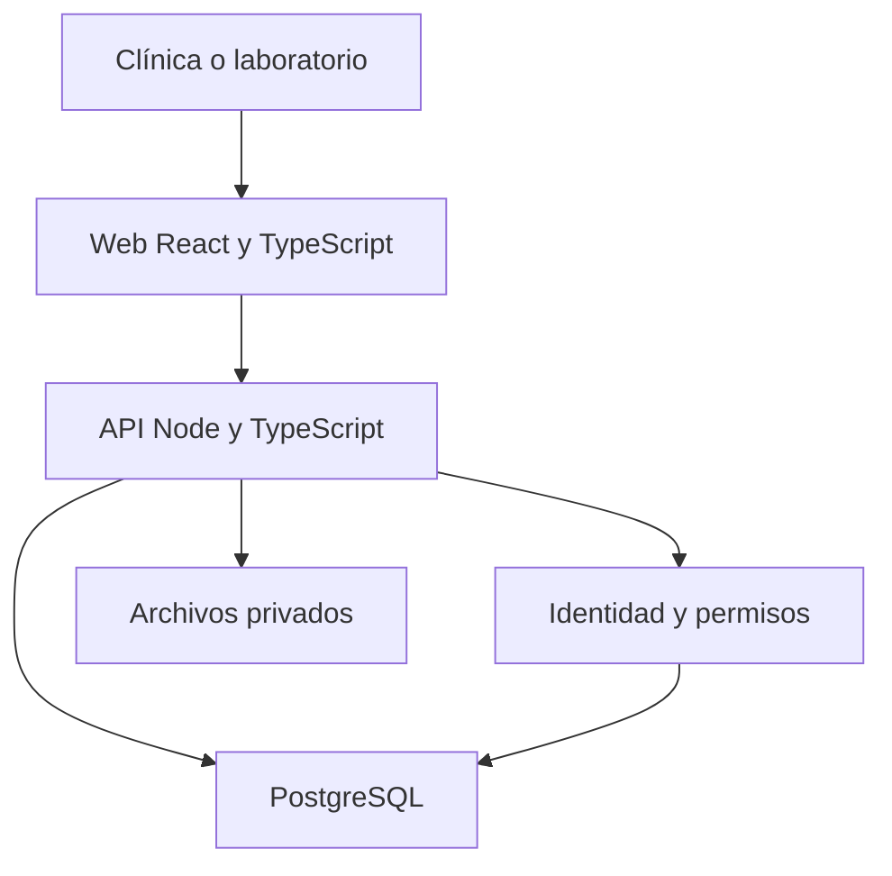

# Alcance, arquitectura y secuencia v0.1

Objetivo: conectar clínica y laboratorio para registrar pacientes, crear casos/órdenes, compartir archivos, recibir diseños, aprobarlos y seguir el trabajo. Se conserva React/TypeScript/Vite para aprovechar las pantallas existentes.

## Alcance mínimo

| Módulo | Resultado esperado | Entrega actual |
|---|---|---|
| Acceso y permisos | Usuario verificado y separación por clínica | Base local implementada. |
| Pacientes | Datos persistentes y accesibles por ID | Alta/lista/consulta implementadas; edición pendiente. |
| Catálogo | Productos, materiales y extras válidos | Tabla inicial; integración pendiente. |
| Casos y órdenes | Caso por ID de paciente y confirmación sin duplicados | Modelo/contrato propuestos; demo visual. |
| Archivos | Carga privada y recuperación autorizada | Modelo/contrato; integración pendiente. |
| Laboratorio y diseños | Correcciones, versiones y aprobación | Modelo/contrato; integración pendiente. |
| Precios y pagos | Total del servidor y verificación manual | Modelo inicial; demo todavía simula pagos. |
| Operación | Piloto, respaldo/restauración y publicación | Pendiente. |

Fuera del mínimo: CAD, diagnóstico con IA, pasarela bancaria, factura electrónica, videollamadas y bloqueo/modificación del escáner. Para PANDA se propone exportar desde Panda Center y cargar archivos. Captura directa con SDK requiere documentación y esfuerzo aprobado.

## Arquitectura de destino

La API verifica sesión, rol y clínica antes de acceder a datos. Los archivos grandes irán a almacenamiento de objetos; PostgreSQL guardará relaciones y metadatos. Ese almacenamiento aún no está conectado.

Localmente Vite sirve la web en 3000 y deriva `/api` al servidor 3001. PGlite conserva el modelo SQL en disco. El navegador no recibe la clave de base de datos ni almacena tokens en localStorage.

## Elecciones y alternativas

| Elección | Motivo concreto | Alternativa |
|---|---|---|
| React/TypeScript/Vite | Reutilizar lo existente | Next.js si aparecen necesidades de renderizado de servidor. |
| Node/TypeScript/Express | Compartir lenguaje; Express ya estaba incluido | Nest para estructura modular; FastAPI si el equipo cuenta con experiencia Python. Stack final por confirmar. |
| PostgreSQL | Relaciones, integridad y transacciones | Una base documental requiere diseñar de otra forma las relaciones/consistencia. |
| Sesiones opacas con cookie HttpOnly | Revocación sencilla y token inaccesible desde JS | Identidad administrada para recuperación, MFA y SSO en producción. |
| PGlite local | Arrancar sin servidor SQL ni nube | PostgreSQL 17 en Docker para validar cliente/servidor y luego servicio administrado. |

Son elecciones de esta base; no son mejores para todos los proyectos. Antes de migrar nube, inventariar Google Cloud y comparar esfuerzo con los recursos que el equipo ya administra.

## Secuencia

1. Repositorio, propiedad y accesos: 05-06/10.
2. Revisar ER y reglas: hasta 07/10 según captura.
3. Revisar autenticación: 06-08/10 según captura; conciliar el 08/10 con el calendario laboral.
4. Pacientes y catálogo; medir esfuerzo y reestimar el 13/10.
5. Casos/órdenes → archivos → laboratorio/diseños → integración.
6. Versión integrada 03/11; piloto 06/11; ensayo 09/11; reserva 10-12/11; salida objetivo 13/11 antes del límite 15/11.

Solo con apoyo confirmado pueden ir en paralelo frontend por contrato, backend y nube. No se agregan horas de terceros ni capacidad por usar IA. La secuencia propuesta no sustituye el cálculo de ruta crítica de MS Project. El plazo depende de alcance/apoyo/reestimación.
