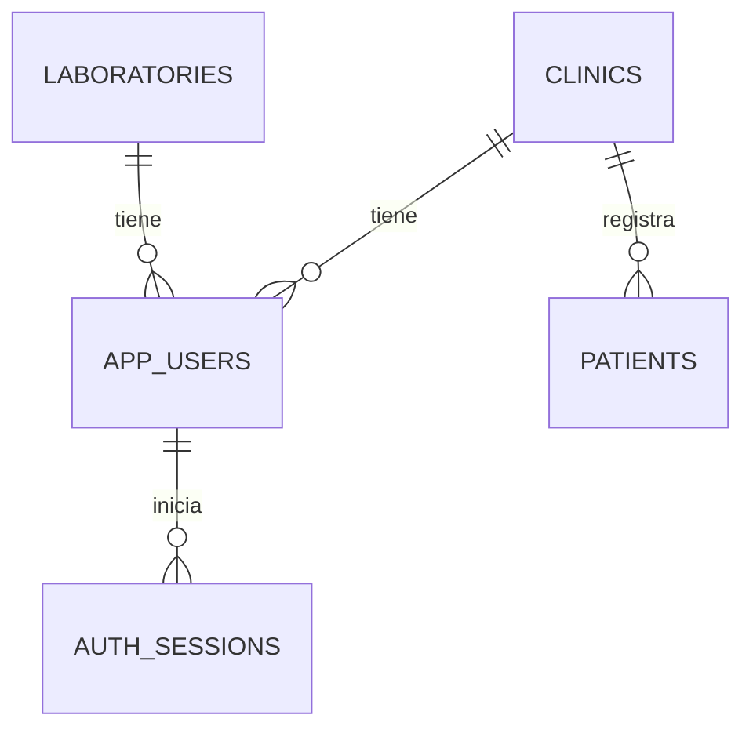
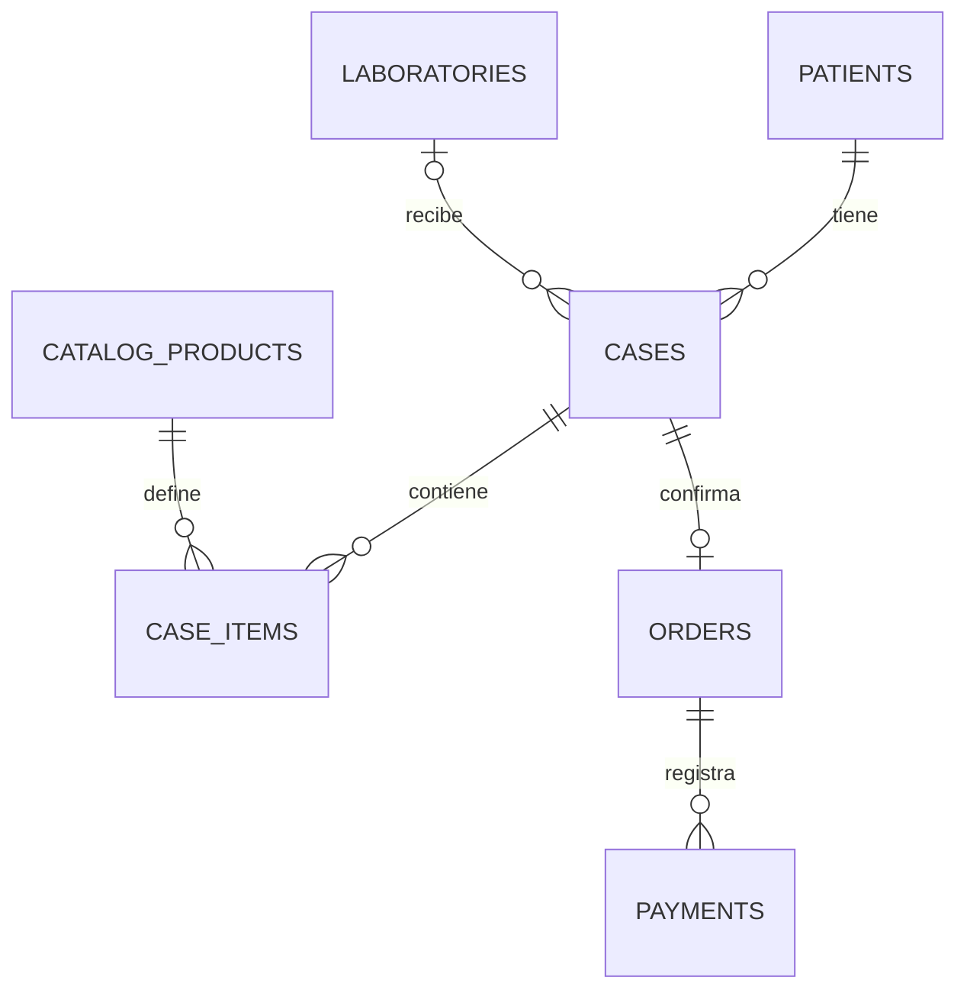
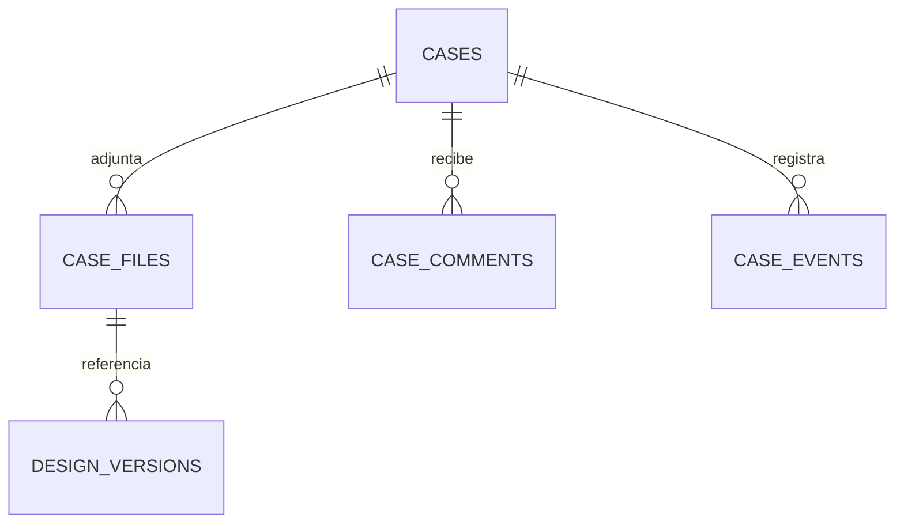

# Modelo entidad-relación y diccionario

ER significa **entidad-relación**. Una entidad suele convertirse en tabla; una relación indica cómo se vinculan sus registros. Una clínica tiene muchos pacientes; los casos utilizan el ID del paciente, nunca su nombre como identificador.

## Identidad

Un usuario pertenece a una clínica **o** a un laboratorio, según rol. Esta versión admite una sola pertenencia. Para cambiar entre varias clínicas se necesita una tabla de membresías y selección de contexto autorizada.

## Trabajo clínico

## Archivos e historial

## Diccionario de 14 tablas

| Tabla | Campos principales | Regla |
|---|---|---|
| clinics | id UUID, name, created_at | Unidad de aislamiento. |
| laboratories | id UUID, name | Organización receptora de casos. |
| app_users | id, email, password_hash, role, clinic_id o laboratory_id, active | Correo único normalizado y pertenencia según rol. |
| auth_sessions | token_hash, user_id, expires_at | Hash de token, caducidad y revocación. |
| patients | id, clinic_id, name, birth_date, gender, internal_id, created_by | Código interno único por clínica. |
| catalog_products | id, code, name, base_price, active | Catálogo base común; precios por clínica por validar. |
| cases | id, clinic_id, patient_id, laboratory_id, status, urgency, due_date | FK compuesta exige paciente de la misma clínica. |
| case_items | id, clinic_id, case_id, product_id, tooth, material, shade, quantity, unit_price | Precio congelado por ítem. Combinaciones por validar en futura API. |
| orders | id, clinic_id, case_id, idempotency_key, subtotal, express_fee, total | Una orden por caso; llave de reintento única por clínica. |
| case_files | id, clinic_id, case_id, object_key, media_type, bytes, sha256, uploaded_by | Guarda metadatos; el archivo será privado y externo. |
| design_versions | id, clinic_id, case_id, file_id, version, status, reviewed_by, reviewed_at | Archivo del mismo caso; revisión de una versión concreta. |
| case_comments | id, clinic_id, case_id, author_id, body, created_at | Comentarios vinculados al caso. |
| payments | id, clinic_id, order_id, amount, status, reference, reviewed_by, reviewed_at | Confirmar/rechazar requiere revisor y fecha. |
| case_events | id, clinic_id, case_id, actor_id, event_type, from_status, to_status | Historial del caso. |

`schema_migrations` es una tabla técnica adicional. `database/001_initial.sql` contiene todos los campos, claves, restricciones e índices.

Aplicado: autorización y filtro de clínica en rutas de pacientes; claves compuestas de paciente/caso/archivo; importes no negativos; total de orden igual a subtotal más recargo. Pendiente: estados, reglas dentales de piezas/materiales, permisos por asignación al laboratorio y límites de archivos. El rango de pieza del SQL es preliminar; no valida todavía todos los números FDI permitidos.

El recargo exprés de S/50 del prototipo debe ratificarse como regla comercial. El esquema admite un importe configurable. No hay políticas RLS en esta base: aislamiento por API y claves compuestas; cada ruta futura necesita su comprobación.

Con el servidor detenido, `npm run db:migrate` aplica 001 una vez. En una base compartida no se edita una migración ya aplicada: se crea 002. Tipos: UUID para identidades; timestamptz para eventos; date para nacimiento/entrega; numeric(12,2) para dinero; bigint para bytes.

Fuentes: https://www.postgresql.org/docs/current/datatype.html · https://node-postgres.com/features/queries · https://pglite.dev/docs/
